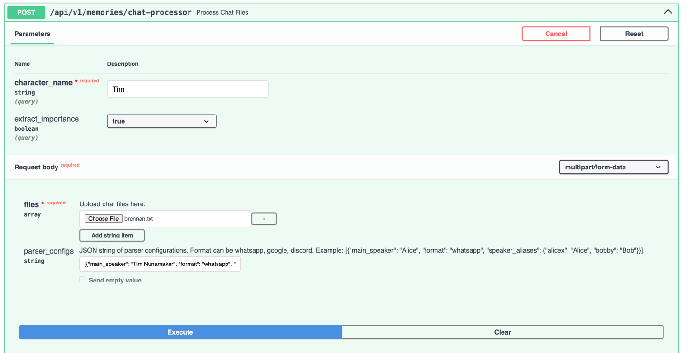
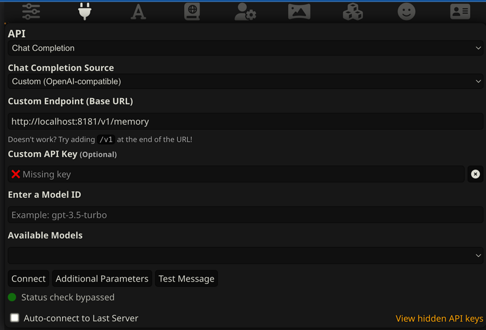
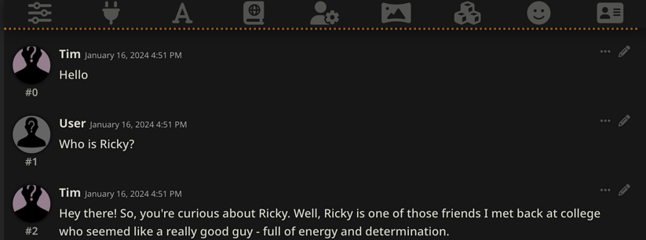
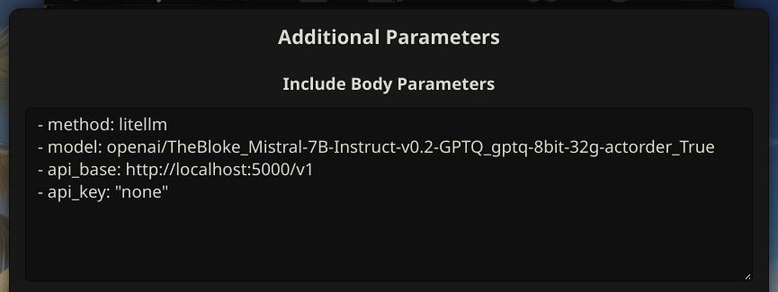

# Selfie

Selfie personalizes text generation, augmenting both local and hosted Large Language Models (LLMs) with your personal data. Selfie exposes an OpenAI-compatible API that wraps the LLM of your choice, and automatically injects relevant context into each text generation request.

## Features

* Dedicated chat message loader that supports WhatsApp and Google Takeout exports.
* Load data using any [LlamaHub loader](https://llamahub.ai/?tab=loaders) (goal, partial support is currently available).
* Drop your data into any tool compatible with an OpenAI API:
  * `/v1/memory/v1/completions` behaves like `/v1/completions` plus context from your data.
  * `/v1/memory/v1/memory/chat_completions` behaves like `/v1/chat_completions` plus context from your data.
* API endpoints for directly querying loaded data.
* Vanilla text generation APIs, if you just want a convenient interface for switching between models.

## Usage

In the future, pre-built executables will be available. For now, you can run selfie with Python:

1. `poetry shell`
2. `poetry install` or `poetry install -E gpu` (to enable GPU devices via transformers). Enable GPU or Metal acceleration via llama.cpp by installing GPU-enabled llama-cpp-python, see Scripts.
3. `python -m selfie`. The first time you run this, it will download ~4gb of model weights. While you wait, you can go download your whatsapp or google takeout data for the next step. 

This starts a local web server at http://localhost:8181.

### Recipe: Importing Chat Messages

1. Open http://localhost:8181/docs
2. Find `POST /v1/memories/chat-processor`
3. Upload one or more exported chat log files. To get these files, export them from platforms that you use frequently and contain information you want the LLM to know. Exports: [Whatsapp](https://faq.whatsapp.com/1180414079177245/?cms_platform=android) | [Google](https://takeout.google.com/settings/takeout) | [Instagram](https://help.instagram.com/181231772500920) | [Facebook Messenger](https://www.facebook.com/help/messenger-app/713635396288741/?cms_platform=iphone-app&helpref=platform_switcher) | [Telegram](https://www.maketecheasier.com/export-telegram-chat-history/). Ensure you ask permission of the friend who is also in the chat you export. You can also redact their name, messages, and other personal information in later steps. 
4. Copy, paste, and edit the example parser_configs JSON. Include one configuration object in the list for each file you upload.



Setting `extract_importance` to `true` will give you better query results, but usually causes the import to take a while.

### Recipe: Connecting with SillyTavern

1. Install and run [SillyTavern](https://github.com/SillyTavern/SillyTavern).
2. Configure a custom chat completion source as  `http://localhost:8181/v1/memory`. You can customize the model by setting API parameters for `method` and `model` in Additional Parameters. \

3. Create a character, customize the text generation settings, etc.
4. Chat with your character to see that it is aware of your data: \
 \

You can also use target a locally hosted OpenAI-compatible API: \
 \
Note: Note that some OpenAI-compatible APIs do not properly handle SillyTavern's use of multiple system messages and non-alternating user/assistant messages (like [text-generation-webui](https://github.com/oobabooga/text-generation-webui)). A workaround is described [here](https://github.com/SillyTavern/SillyTavern/issues/1722#issuecomment-1902619716).

## Augmenting Local Models

Selfie uses [txtai](https://neuml.github.io/txtai) to download local models and run them with [llama.cpp](https://github.com/ggerganov/llama.cpp). In completion requests, specify the `llama.cpp` method, or leave it off as the default, and ensure that your model is defined correctly, as a local path or HuggingFace model, according to [txtai's documentation](https://neuml.github.io/txtai/models).

```json
"method": "llama.cpp"
"model": "~/models/dolphin-2.6-mistral-7b-dpo.Q5_K_M.gguf"
```
or
```json
"method": "llama.cpp"
"model": "TheBloke/dolphin-2.6-mistral-7B-dpo-GGUF/dolphin-2.6-mistral-7b-dpo.Q5_K_M.gguf"
```

You can even use a local Open-AI compatible API using the litellm method ([LiteLLM OpenAI-Compatible Endpoints docs](https://litellm.vercel.app/docs/providers/openai_compatible)).
```json
"method": "litellm"
"model": "openai/TheBloke_Mistral-7B-Instruct-v0.2-GPTQ_gptq-8bit-32g-actorder_True"
"api_base": "http://localhost:5000/v1"
"api_key": "none"
```

## Augmenting Hosted Models

Selfie uses [txtai](https://neuml.github.io/txtai) to connect to hosted models with [litellm](https://litellm.vercel.app). In completion requests, specify the `litellm` method (optional) and ensure that your model is prefixed correctly according to [litellm's documentation for your provider](https://docs.litellm.ai/docs/providers).

```json
"method": "litellm",
"model": "replicate/llama-2-70b-chat:2796ee9483c3fd7aa2e171d38f4ca12251a30609463dcfd4cd76703f22e96cdf",
```

In general, you need an API key for your provided loaded into your environment. A quick way to do that is to specify it when you start the server:
`REPLICATE_API_KEY=replicatekey python -m selfie`.

## Building an Executable

Build an executable for your platform with `pyinstaller selfie.spec --noconfirm`.

Start the built service with `./dist/selfie/selfie`.

## Scripts

Scripts are provided in scripts/ to help with common tasks.

### llama-cpp-python-cublas.sh

To install llama.cpp with CUDA support for better performance, run `./scripts/llama-cpp-python-cublas.sh`. [ROCm](https://github.com/jllllll/llama-cpp-python-cuBLAS-wheels/releases/tag/rocm) and [Metal](https://github.com/jllllll/llama-cpp-python-cuBLAS-wheels/releases/tag/metal) versions should be installed manually.

Alternatively, you can build `llama-cpp-python` manually with the flags of your choice by following [the instructions](https://github.com/abetlen/llama-cpp-python?tab=readme-ov-file#installation).